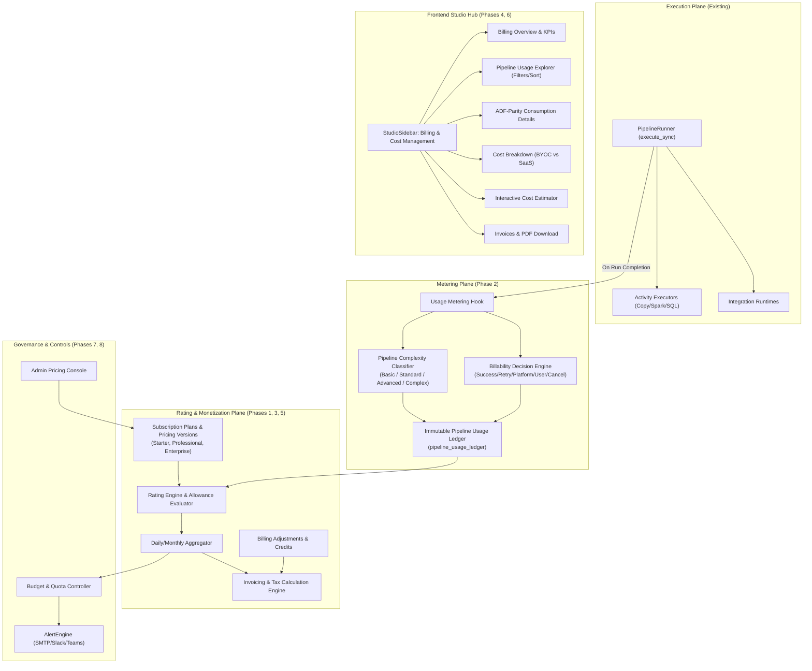
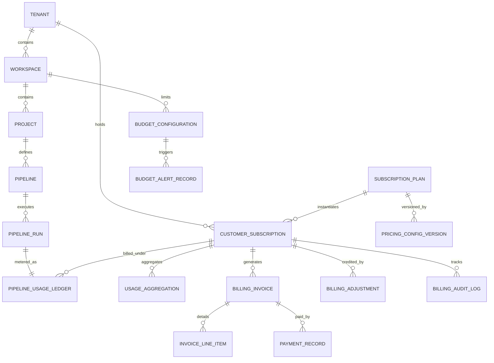

# DataForge – Billing & Usage-Based Monetization Architecture

**Document Version:** 1.0.0  
**Status:** Phase 0 Architecture Audit & Blueprint  
**Governing Charter:** [GEMINI.md](file:///home/fifity-five/projects/Dataforge/GEMINI.md)  
**Author:** DataForge Architecture Team  

---

## 1. Architectural Mission & Objectives

The **DataForge Billing & Usage-Based Monetization Module** is an enterprise-grade rating, metering, and invoicing subsystem designed to make DataForge commercially viable and transparently competitive against hyperscaler services like Azure Data Factory (ADF) and AWS Glue.

### Key Tenets
1. **Zero Interference with Execution Hot Path:** Usage metering records are generated asynchronously upon run completion or transactional checkpoints without injecting latency into the pipeline execution loop.
2. **Deterministic Idempotency:** The unique `pipeline_run_id` serves as a natural idempotency key. Duplicate worker retries, event replays, or network drops never create duplicate usage ledger entries.
3. **Immutability:** Once rated and committed, usage ledger entries are immutable. Corrections, refunds, or customer credits are stored as distinct ledger adjustment records (`BillingAdjustment`).
4. **Transparent Cloud Cost Attribution:** Strict segregation between **DataForge Platform Software Charges** (Subscription + Execution Surcharges) and **Underlying Cloud Infrastructure Costs** (AWS, Azure, GCP compute/storage/egress). In Bring-Your-Own-Cloud (BYOC) environments, DataForge never fabricates or pretends to know actual cloud bills without an explicit cloud billing integration.

---

## 2. Existing DataForge System Audit & Component Reusability

An in-depth inspection of the existing DataForge codebase reveals high-value components that will be directly reused to build the monetization engine:

| Existing DataForge Component | Location | Role in Billing & Monetization |
| :--- | :--- | :--- |
| **Pipeline Runner & Lifecycle** | [`backend/app/execution/runner.py`](file:///home/fifity-five/projects/Dataforge/backend/app/execution/runner.py) | **Primary Hook:** Hooks directly into `PipelineRunner.execute_sync()` lines 390–405 upon final run status calculation (`Succeeded`, `Failed`, `Cancelled`). |
| **Pipeline & Activity Runs** | [`backend/app/models/execution.py`](file:///home/fifity-five/projects/Dataforge/backend/app/models/execution.py) | **Telemetry Source:** Provides verified row counts (`total_rows_read`, `total_rows_written`), payload volume (`total_bytes_processed`), duration (`duration_seconds`), activity counts, and `worker_info`. |
| **Activity Error Classification** | [`backend/app/models/execution.py#L52`](file:///home/fifity-five/projects/Dataforge/backend/app/models/execution.py#L52) | **Billability Determination:** `error_classification` distinguishes `SystemError` (Platform failure $\rightarrow$ Non-billable) from `UserError` / `DataQualityError` (Customer configuration failure $\rightarrow$ Billable). |
| **Workspace & Multi-Tenancy** | [`backend/app/models/workspace.py`](file:///home/fifity-five/projects/Dataforge/backend/app/models/workspace.py) | **Isolation Boundary:** Workspaces group projects, pipelines, and runs. Enhanced with Tenant/Organization references. |
| **RBAC & Security Vault** | [`backend/app/core/rbac.py`](file:///home/fifity-five/projects/Dataforge/backend/app/core/rbac.py) | **Access Control:** Enforces permissions via `require_role(["Admin"])` for pricing administration and `check_workspace_permission` for tenant billing views. |
| **Alert & Notification Engine** | [`backend/app/monitoring/alert_engine.py`](file:///home/fifity-five/projects/Dataforge/backend/app/monitoring/alert_engine.py) | **Budget Notifications:** Dispatches automated email, Slack, Teams, and Webhook alerts when monthly budget thresholds (50%, 75%, 90%, 100%) are breached. |
| **Integration Runtimes** | [`backend/app/models/runtime.py`](file:///home/fifity-five/projects/Dataforge/backend/app/models/runtime.py) | **Runtime Attribution:** Tracks compute consumption on Cloud vs Self-Hosted runtimes for infrastructure rating. |
| **Execution Engines** | [`backend/app/engine/`](file:///home/fifity-five/projects/Dataforge/backend/app/engine/) | **Engine Affinity:** Differentiates runs powered by Copy Engine, Spark Engine, and SQL Pushdown Engine. |
| **Frontend Design System** | `frontend/src/components/common/` | **UI Components:** Reuses `StudioTable`, `StudioTabs`, `MetricCard`, `QuickActionCard`, and dark-mode styling for zero visual regression. |

---

## 3. High-Level Architecture Diagram

---

## 4. Entity-Relationship Data Model

---

## 5. Domain Entities & Database Schema Specification

### 1. `tenants` & `organizations`
- `id` (VARCHAR(36), PK): UUID.
- `name` (VARCHAR(150), UNIQUE): Customer legal organization name.
- `billing_email` (VARCHAR(255)): Contact email for invoices.
- `currency` (VARCHAR(3), DEFAULT 'INR'): Billing currency (INR, USD, EUR, GBP).
- `country` (VARCHAR(2), DEFAULT 'IN'): Country code for tax calculation (e.g. GST in India).
- `tax_identifier` (VARCHAR(50)): GSTIN / VAT ID.
- `deployment_model` (VARCHAR(20), DEFAULT 'BYOC'): 'BYOC', 'SaaS', 'Hybrid'.
- `created_at` (TIMESTAMP).

### 2. `subscription_plans`
- `id` (VARCHAR(36), PK): UUID.
- `plan_code` (VARCHAR(50), UNIQUE): 'starter', 'professional', 'enterprise', 'custom'.
- `name` (VARCHAR(100)): 'Starter Plan', 'Professional Plan', 'Enterprise Plan'.
- `description` (TEXT).
- `is_active` (BOOLEAN, DEFAULT TRUE).
- `is_custom` (BOOLEAN, DEFAULT FALSE).
- `created_at` (TIMESTAMP).

### 3. `pricing_config_versions`
- `id` (VARCHAR(36), PK): UUID.
- `plan_id` (VARCHAR(36), FK $\rightarrow$ `subscription_plans.id`).
- `version_number` (INTEGER, NOT NULL): Monotonically increasing version (v1, v2).
- `monthly_base_price` (DECIMAL(12, 2)): ₹9,999 (Starter), ₹29,999 (Professional), ₹99,999 (Enterprise).
- `annual_base_price` (DECIMAL(12, 2)): Discounted annual rate.
- `included_pipeline_runs` (INTEGER): 10,000 (Starter), 50,000 (Professional), 250,000 (Enterprise).
- `basic_run_rate` (DECIMAL(8, 4)): ₹0.50 (2–5 activities).
- `standard_run_rate` (DECIMAL(8, 4)): ₹1.50 (6–15 activities).
- `advanced_run_rate` (DECIMAL(8, 4)): ₹3.00 (16–30 activities).
- `complex_run_rate` (DECIMAL(8, 4)): Custom / surcharge (30+ activities).
- `spark_node_hour_rate` (DECIMAL(10, 4)): SaaS rate for Spark compute.
- `sql_pushdown_rate` (DECIMAL(8, 4)): Zero-egress ELT run charge.
- `currency` (VARCHAR(3), DEFAULT 'INR').
- `effective_from` (TIMESTAMP).
- `effective_to` (TIMESTAMP, NULLABLE).
- `created_by_id` (VARCHAR(36)).
- `created_at` (TIMESTAMP).

### 4. `customer_subscriptions`
- `id` (VARCHAR(36), PK): UUID.
- `tenant_id` (VARCHAR(36), FK $\rightarrow$ `tenants.id`).
- `plan_id` (VARCHAR(36), FK $\rightarrow$ `subscription_plans.id`).
- `pricing_version_id` (VARCHAR(36), FK $\rightarrow$ `pricing_config_versions.id`).
- `billing_period` (VARCHAR(20), DEFAULT 'Monthly'): 'Monthly', 'Annual'.
- `status` (VARCHAR(20), DEFAULT 'Active'): 'Active', 'PastDue', 'Suspended', 'Cancelled', 'Trial'.
- `current_period_start` (TIMESTAMP).
- `current_period_end` (TIMESTAMP).
- `cancel_at_period_end` (BOOLEAN, DEFAULT FALSE).
- `custom_agreement_notes` (TEXT).
- `created_at` (TIMESTAMP).

### 5. `pipeline_usage_ledger` (Immutable Metering Ledger)
- `id` (VARCHAR(36), PK): UUID.
- `tenant_id` (VARCHAR(36), INDEX).
- `workspace_id` (VARCHAR(36), INDEX).
- `project_id` (VARCHAR(36)).
- `pipeline_id` (VARCHAR(36), INDEX).
- `pipeline_name` (VARCHAR(150)).
- `pipeline_run_id` (VARCHAR(36), UNIQUE, INDEX): Idempotency natural key.
- `execution_type` (VARCHAR(30)): 'Manual', 'Scheduled', 'Triggered', 'ChildPipeline'.
- `execution_engine` (VARCHAR(30)): 'CopyEngine', 'SparkEngine', 'SqlPushdownEngine', 'Hybrid'.
- `activity_count` (INTEGER): Total activities in DAG.
- `classification` (VARCHAR(20)): 'Basic', 'Standard', 'Advanced', 'Complex'.
- `started_at` (TIMESTAMP).
- `ended_at` (TIMESTAMP).
- `duration_seconds` (INTEGER).
- `execution_status` (VARCHAR(30)): 'Succeeded', 'Failed', 'Cancelled'.
- `retry_count` (INTEGER).
- `runtime_id` (VARCHAR(36), NULLABLE).
- `rows_processed` (BIGINT).
- `bytes_processed` (BIGINT).
- `billing_period_key` (VARCHAR(7), INDEX): 'YYYY-MM' (e.g. '2026-11').
- `is_billable` (BOOLEAN, NOT NULL).
- `non_billable_reason` (VARCHAR(100), NULLABLE): 'PlatformSystemError', 'CancelledBeforeStart', 'InternalRetry', 'ValidationCheck'.
- `calculated_charge` (DECIMAL(10, 4), DEFAULT 0.0000).
- `pricing_version_id` (VARCHAR(36)).
- `recorded_at` (TIMESTAMP, DEFAULT UTC).

### 6. `usage_aggregations` (Hourly/Daily/Monthly Rollups)
- `id` (VARCHAR(36), PK).
- `tenant_id` (VARCHAR(36), INDEX).
- `subscription_id` (VARCHAR(36)).
- `period_key` (VARCHAR(7)): '2026-11'.
- `total_runs` (INTEGER).
- `billable_runs` (INTEGER).
- `non_billable_runs` (INTEGER).
- `basic_runs` (INTEGER).
- `standard_runs` (INTEGER).
- `advanced_runs` (INTEGER).
- `complex_runs` (INTEGER).
- `spark_runs` (INTEGER).
- `sql_pushdown_runs` (INTEGER).
- `included_runs_consumed` (INTEGER).
- `overage_runs` (INTEGER).
- `total_overage_charge` (DECIMAL(12, 2)).
- `last_calculated_at` (TIMESTAMP).

### 7. `billing_invoices` & `invoice_line_items`
- Invoice: `id`, `tenant_id`, `subscription_id`, `invoice_number` (e.g. `DF-INV-2026-11-0001`), `billing_period_start`, `billing_period_end`, `subtotal_amount`, `tax_percent` (18% GST), `tax_amount`, `adjustments_amount`, `total_amount`, `currency`, `status` ('Draft', 'Issued', 'Paid', 'Void'), `due_date`, `pdf_storage_path`.
- Line items: `id`, `invoice_id`, `description`, `item_type` ('SubscriptionBase', 'OverageBasic', 'OverageStandard', 'OverageAdvanced', 'ComputeSpark', 'CreditAdjustment'), `quantity`, `unit_price`, `amount`.

### 8. `budget_configurations` & `budget_alerts`
- Budget Config: `id`, `workspace_id`, `project_id`, `monthly_limit_amount`, `monthly_run_limit`, `enforce_hard_limit` (BOOLEAN, DEFAULT FALSE), `alert_recipients` (JSON), `is_active`.
- Alert Records: `id`, `budget_id`, `threshold_percent` (50, 75, 90, 100), `triggered_at`, `notification_channel`, `status`.

---

## 6. Billing Rules State Machine

| Scenario | State / Conditions | Billable? | Reason Recorded | Charge Applied |
| :--- | :--- | :---: | :--- | :--- |
| **Pipeline Succeeded** | `status == 'Succeeded'` | **Yes** | `None` | Classified by activity count; counted against allowance or overage. |
| **User Manual Rerun** | New `PipelineRun` created | **Yes** | `None` | Distinct `pipeline_run_id` rated as an independent execution. |
| **Automatic Worker Retry** | Retry inside same `PipelineRun` | **No additional** | `InternalTaskRetry` | Single overall run charge for the parent run. |
| **Platform Infrastructure Failure** | `status == 'Failed'` and `error_classification == 'SystemError'` | **No** | `PlatformSystemError` | ₹0.00 (Customer is never billed for DataForge crashes or system faults). |
| **Customer Configuration Failure** | `status == 'Failed'` and `error_classification in ('UserError', 'DataQualityError')` | **Yes** | `None` | Normal execution charge applied (compute was provisioned). |
| **Cancelled Before Execution** | Cancelled while in `Pending` | **No** | `CancelledBeforeStart` | ₹0.00. |
| **Cancelled During Execution** | Cancelled while in `Running` | **Yes** | `CancelledDuringRun` | Billable (compute consumed up to cancellation). |
| **Child Pipeline Execution** | Executed via `ExecutePipelineActivity` | **Yes** | `None` | Sub-pipeline gets its own unique run ID and is billed independently. |
| **Pre-Execution Validation** | Pipeline DAG validation endpoint | **No** | `PreExecutionValidation` | ₹0.00 (Control plane validation is completely free). |

---

## 7. Security, Tenant Isolation & Governance

1. **Strict Tenant Scoping:** Every billing endpoint inspects the authenticated user's workspace/tenant access via `check_workspace_permission` or `require_role(["Admin"])`. No tenant can query or see another tenant's ledger, subscription, or invoices.
2. **Audit Logging:** Any manual rating override, subscription change, discount injection, or billing credit writes an immutable entry into `billing_audit_logs`.
3. **No Hardcoded Secrets or Credentials:** Any payment gateway or cloud billing API keys are stored encrypted via AES-256 Fernet in `SecretVaultEntry`.
4. **Idempotency Guarantee:** Unique database constraint on `pipeline_usage_ledger.pipeline_run_id` ensures that even under concurrent race conditions or distributed worker crashes, a run is metered at most once.

---

## 8. Extensible Payment Provider Interface

To maintain production integrity and comply with Section 16 guardrails, payment processing uses an explicit provider interface (`BasePaymentGateway`) with:
- `OfflineBankTransferAdapter` (Standard B2B invoice & wire transfer)
- `StripePaymentAdapter` (Stripe subscriptions & cards)
- `RazorpayPaymentAdapter` (INR cards, UPI & NetBanking)

When no external gateway credentials are configured, the system cleanly operates in **B2B Invoicing Mode** with audit-verified manual status reconciliation, never simulating fake credit card transactions.
