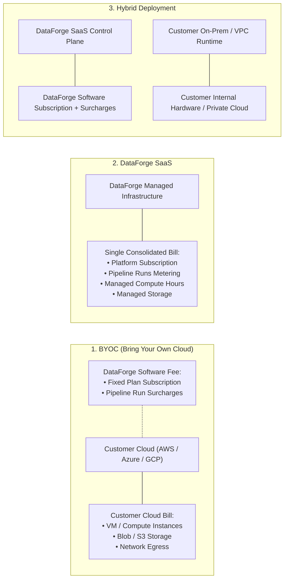

# DataForge – Commercial Pricing & Rating Model Specification

**Document Version:** 1.0.0  
**Status:** Phase 0 Approved Architecture Model  
**Currency Standard:** Primary: INR (₹), Secondary: USD ($), EUR (€), GBP (£)  
**Governing Charter:** [GEMINI.md](file:///home/fifity-five/projects/Dataforge/GEMINI.md)  

---

## 1. Commercial Pricing Overview

DataForge delivers an alternative to hyperscaler data integration tools like Azure Data Factory (ADF) with a transparent, predictable pricing structure. The model marries a fixed predictable platform baseline with granular, pay-as-you-scale usage metering.

The financial model consists of five pillars:
1. **Base Monthly Subscription Platform Fee:** Covers control plane, orchestration engine, visual designer, connectors, monitoring, and security.
2. **Included Monthly Execution Allowance:** Generous allocation of standard pipeline runs included at zero extra cost.
3. **Activity-Tiered Overage Run Surcharges:** Transparent graduated pricing per additional run exceeding the included allowance.
4. **Specialized Compute Surcharges (Spark Engine & SaaS Hosted Runtimes):** Resource-rated compute billing where applicable.
5. **Custom Enterprise Licensing & Agreements:** Negotiated volume pricing, SLA commitments, and tailored deployment guarantees.

---

## 2. Standard Subscription Plans

| Parameter | Starter Plan | Professional Plan | Enterprise Plan |
| :--- | :--- | :--- | :--- |
| **Plan Code** | `starter` | `professional` | `enterprise` |
| **Monthly Subscription** | **₹9,999 / month** | **₹29,999 / month** | **₹99,999 / month onwards** |
| **Annual Commitment (Discounted)** | ₹99,990 / year (2 mos free) | ₹299,990 / year (2 mos free) | Custom annual contract |
| **Included Monthly Pipeline Runs** | **10,000 runs / month** | **50,000 runs / month** | **250,000+ runs / month** |
| **Copy Engine Support** | Basic Streaming Copy | Advanced Parallel Partitioner | Full High-Throughput & Partitioning |
| **Spark Engine Support** | — | PySpark Distributed Compute | Full Multi-Node Cluster Integration |
| **SQL Pushdown Engine** | — | In-Database Zero-Egress ELT | Enterprise Multi-Warehouse Pushdown |
| **Data Quality & Profiling** | Basic DQ Checks | Advanced DQ & Reconciliation | Full Continuous Automated Profiling |
| **Modern Data Stack Connectors** | Postgres, MySQL, S3, ADLS, GCS | Snowflake, BigQuery, DuckDB, Redshift, dbt | Custom Enterprise Adapters & CDC |
| **Git & CI/CD Sync** | — | Full Git Sync & Promotion | Multi-Branch Environments & RBAC |
| **Execution Runtimes** | Shared Cloud Runtimes | Dedicated Cloud Runtimes | Self-Hosted On-Prem & VPC Runtimes |
| **Support & SLA** | Standard Business Hours | Priority 24/5 Support | Dedicated Solutions Architect & 99.9% SLA |

---

## 3. Graduated Activity-Count Execution Surcharges

When a workspace exceeds its monthly included run allowance, each additional pipeline execution is billed based on its activity complexity count.

```
       [ 1 to 5 Activities ]     -> Basic Tier     (₹0.50 / run)
       [ 6 to 15 Activities ]    -> Standard Tier  (₹1.50 / run)
       [ 16 to 30 Activities ]   -> Advanced Tier  (₹3.00 / run)
       [ 31+ Activities ]        -> Complex Tier   (Configurable / ₹5.00 base)
```

| Complexity Tier | Activity Count Threshold | Surcharge per Additional Run (INR) | Equivalent USD ($) | Description |
| :--- | :---: | :---: | :---: | :--- |
| **Basic** | **2 – 5 activities** | **₹0.50** | ~\$0.006 | Point-to-point ingestion (e.g. MySQL $\rightarrow$ S3, Single Table Copy with simple validation). |
| **Standard** | **6 – 15 activities** | **₹1.50** | ~\$0.018 | Multi-table ingestion, lookup joins, parameter lookups, and basic data quality verification. |
| **Advanced** | **16 – 30 activities** | **₹3.00** | ~\$0.036 | Complex orchestrations with loops, conditional branches, transformations, and error traps. |
| **Complex** | **31+ activities** | **Custom (Default ₹5.00)** | ~\$0.060 | Enterprise composite pipelines, deep hierarchical sub-pipelines, and massive multi-source reconciliations. |

> [!NOTE]
> Single activity test executions (1 activity) are billed at the **Basic Tier** rate (₹0.50). Pipeline DAG validation checks are always **100% free** (₹0.00).

---

## 4. Execution Engine Rating & Compute Multipliers

DataForge distinguishes between pure control-plane orchestration and resource-heavy distributed compute.

### A. Copy Engine (Bounded-Memory Streaming)
- **Architecture:** Zero-Spark, bounded transfer buffer ($\le 64\text{ MB}$ per partition) with backpressure.
- **Rating:** Standard activity tier pricing applies. Zero additional compute fees in BYOC mode.

### B. SQL Pushdown Engine (Zero-Egress In-Database ELT)
- **Architecture:** Native SQL transformation compiled to Snowflake, BigQuery, Redshift, DuckDB, PostgreSQL, MySQL.
- **Rating:** Standard activity tier pricing applies. DataForge charges **zero egress or compute markup**, saving customers thousands compared to ADF's Data Flow compute hours.

### C. Spark Engine (Distributed Cluster Compute)
- **BYOC Mode:** Customer provisions Databricks, EMR, or local Spark clusters. DataForge rates only the orchestration run; the customer pays their cloud provider directly.
- **SaaS Hosted Mode:** When DataForge provides managed compute workers, compute consumption is rated per node-hour:
  - General Compute Worker (4 vCPU, 16 GB RAM): ₹45.00 / worker-hour.
  - High-Memory Worker (8 vCPU, 32 GB RAM): ₹90.00 / worker-hour.

---

## 5. Deployment Model Financial Boundaries

A central tenet of DataForge is clear financial transparency between software licensing and cloud infrastructure:



### Critical Financial Rule
In **BYOC** mode, DataForge REST APIs, invoices, and dashboards will **strictly separate** DataForge software charges from estimated cloud provider costs. Estimated cloud infrastructure metrics will always be explicitly labeled:
$$\text{Estimated Cloud Consumption (Infrastructure)} \neq \text{DataForge Platform Invoice}$$

---

## 6. Dynamic Pricing Configuration & Versioning Lifecycle

To protect customer trust and comply with accounting standards:
1. **Immutable Historical Pricing:** Invoices already generated can **never** be retroactively modified by pricing updates.
2. **Effective Dating:** Pricing configuration changes create a new `PricingConfigVersion` record with `effective_from` timestamps. Existing active subscriptions remain pegged to their agreed version until scheduled renewal or explicit migration.
3. **Multi-Currency Normalization:** The administrative configuration stores baseline exchange rates and roundings for INR, USD, EUR, and GBP.
4. **Tax Handling:** Standard enterprise taxation (e.g. 18% GST in India) is calculated as an explicit line item, with support for tax exemptions upon presentation of verified tax identifiers (GSTIN/VAT).
