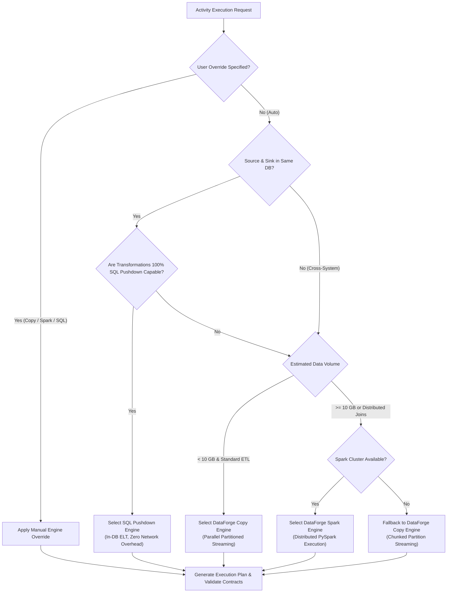

# DataForge Intelligent Execution Engine – Master Architecture Blueprint

## 1. Executive Summary

The **DataForge Intelligent Execution Engine** is a high-performance, multi-modal compute and data movement framework designed to scale data processing seamlessly from megabytes to terabytes.

Modern enterprise data platforms face three conflicting execution requirements:
1. **Lightweight, High-Speed Data Movement:** Simple bulk ingest or multi-cloud file transfers should not incur the overhead, startup latency, or resource cost of a distributed Apache Spark cluster.
2. **Distributed Big Data Processing:** Complex joins, heavy aggregations, and windowing over multi-gigabyte or terabyte datasets require distributed in-memory partitioning (Apache Spark / PySpark).
3. **Database-Native Compute (ELT Pushdown):** When data already resides within relational or cloud data warehouses (PostgreSQL, MySQL, Snowflake, DuckDB), transformations should execute inside the database engine via pushdown SQL, eliminating network transfer costs and serialization overhead.

The Intelligent Execution Engine introduces:
- **DataForge Copy Engine:** Multi-threaded, partitioned, streaming data movement with bounded-memory backpressure and checkpoint resume.
- **DataForge Spark Engine:** Automated distributed PySpark generation and execution for massive scale.
- **DataForge SQL Pushdown Engine:** AST-based dialect translation compiling visual transformation DAGs into database-native queries.
- **Intelligent Execution Planner:** An automated optimizer that analyzes connector affinity, dataset volumes, schema complexity, and hardware resources to select the optimal engine while honoring manual developer overrides.

```
+----------------------------------------------------------------------------------------------------+
|                                    DataForge Pipeline DAG                                         |
+----------------------------------------------------------------------------------------------------+
                                                  │
                                                  ▼
+----------------------------------------------------------------------------------------------------+
|                                   Intelligent Execution Planner                                    |
|   - Cost & Heuristic Optimization (Volume, Complexity, Connector Affinity, Compute Availability)    |
|   - Policy Engine (Auto / Force Copy / Force Spark / Force Pushdown)                               |
+-----------------------------------+--------------------------------+-------------------------------+
                                    │                                │
            ┌───────────────────────┼────────────────────────────────┐
            ▼                       ▼                                ▼
+───────────────────────+ +───────────────────────+ +────────────────────────────────────────────────+
|  DataForge Copy       | |  DataForge SQL        | |  DataForge Spark                               |
|  Engine               | |  Pushdown Engine      | |  Engine                                        |
|  (Parallel Streaming) | |  (Native In-DB ELT)   | |  (Distributed PySpark Cluster)                 |
+───────────────────────+ +───────────────────────+ +────────────────────────────────────────────────+
| • Partitioned Slices  | • AST Graph Parser      | • PySpark Script Generator                       |
| • Bounded Buffer Queue| • Dialect Compiler      | • Spark-Submit / REST Gateway                    |
| • Zero Spark Overhead | • In-DB CTAS / Merge    | • Distributed Partition Stages                   |
| • Checkpoint Recovery | • Zero Network Egress   | • Catalyst Plan Optimization                     |
+───────────────────────+ +───────────────────────+ +────────────────────────────────────────────────+
            │                       │                                │
            └───────────────────────┼────────────────────────────────┘
                                    ▼
+----------------------------------------------------------------------------------------------------+
|                                 Runtime Worker Fleet (Cloud / SHIR)                                |
| • Independent OS Worker Process   • Bounded RAM Backpressure    • Live Telemetry & OpenTelemetry   |
+----------------------------------------------------------------------------------------------------+
```

---

## 2. Core Architectural Principles

1. **Strict Engine Independence:** Each of the three engines (Copy, Spark, SQL Pushdown) is an independent module with its own contract and test suite. Failure in Spark tooling cannot destabilize the Copy Engine or core pipeline runner.
2. **Reuse Existing Connectors & Activities:** Extends the existing `BaseConnector`, `BaseStorageConnector`, and `CopyDataActivity` without breaking existing workflows or requiring schema migrations for legacy pipelines.
3. **Decoupled Worker Architecture:** Zero heavy data movement occurs inside the FastAPI web server thread. Workloads execute on dedicated worker threads, sub-processes, or distributed Integration Runtime (IR) nodes.
4. **Bounded-Memory Streaming:** All stream operations employ backpressure queues with hard upper bounds (default $\le 64\text{ MB}$ per partition), preventing Out-Of-Memory (OOM) failures even when handling terabyte-scale tables.
5. **Partitioning, Concurrency & Resumable Checkpoints:** Supports range-based, hash-based, and multi-file partitioning. Each partition writes checkpoint tokens upon completion, enabling partial retry without re-transferring billions of records.
6. **Strict Idempotency:** Writes use transactional staging buffers, deterministic UUID prefixes, or database upsert/merge logic to ensure zero data duplication upon retry.
7. **Unified Monitoring & Observability:** Real-time metrics (throughput, partition progress, pushdown query plans, Spark stage progress, memory utilization) emit through the existing `ActivityRun.metrics` and OpenTelemetry traces.

---

## 3. Engine 1: DataForge Copy Engine

### 3.1 Purpose & Scope
The Copy Engine delivers high-speed, parallel data transfer between databases, file systems, and multi-cloud object storage (AWS S3, Azure Blob/ADLS, Google Cloud Storage, Local Files, PostgreSQL, MySQL, SQLite) without spinning up Spark clusters or incurring JVM startup latency.

### 3.2 Partitioning Strategies
1. **Range Partitioning:** Divides numeric, date, or timestamp columns into non-overlapping slices:
   $$\text{Slice}_i = \left[\text{Min} + i \cdot \Delta,\; \text{Min} + (i+1) \cdot \Delta\right)$$
   Parallel workers extract slices concurrently using parameterized index queries (`WHERE id >= ? AND id < ?`).
2. **File-Set Partitioning:** For multi-file cloud storage or directory sources, partitions the file list into balanced batches across concurrent worker threads.
3. **Multi-Part Cloud Transfer:** Large single files ($> 100\text{ MB}$) are transferred using parallel byte-range HTTP GET/PUT requests with concurrent chunk uploads.

### 3.3 Streaming Pipeline Architecture
```
Source Connector ──────► Bounded Buffer Queue ──────► Format Transcoder ──────► Sink Writer
 (Read Stream)               (Max 4 Chunks)               (Arrow/Polars)          (Batch Write)
                             ▲ Backpressure               (Zero-Copy)
                             │
                     CancellationToken
```
- **Bounded Transfer Buffer:** Thread-safe queue (`BoundedTransferBuffer`) with a hard cap on queued memory. When the sink writer is slower than the source, the reader thread blocks automatically, establishing natural backpressure.
- **Zero-Copy Transcoding:** Employs Apache Arrow columnar record batches for conversions (e.g. CSV $\to$ Parquet $\to$ Database), avoiding Python dict serialization overhead.
- **Checksum Verification:** Computes streaming cryptographic digests (MD5, SHA-256) on the fly without second-pass reads.

### 3.4 Checkpoint & Resume Architecture
- State ledger tracks `partition_id`, `status`, `rows_written`, `bytes_transferred`, and `watermark_position`.
- When an execution fails on partition $k$ of $N$, the retry manager resumes only the remaining partitions, preserving completed partitions.

---

## 4. Engine 2: DataForge Spark Engine

### 4.1 Purpose & Scope
The Spark Engine handles distributed transformations and massive dataset processing that exceed the memory capacity of a single machine or require distributed joins, complex groupings, and iterative compute.

### 4.2 Architecture & Execution Modes
1. **Local PySpark:** For medium-scale development, testing, and single-node multi-core processing ($1\text{ GB} - 50\text{ GB}$).
2. **Distributed Cluster (Standalone / YARN / Kubernetes):** Connects to remote Spark clusters via `spark-submit` or Apache Livy REST Gateway.
3. **Databricks Integration:** Submits ephemeral or persistent jobs to Databricks clusters using existing Databricks linked services.

### 4.3 DataFlow DAG to PySpark Compilation
The Spark Engine automatically compiles DataForge visual DataFlow transformation DAGs into executable PySpark code:
- **Source Node** $\to$ `spark.read.format("parquet").load(...)` or JDBC query.
- **Filter Node** $\to$ `df.filter(...)`
- **Derived Column** $\to$ `df.withColumn(...)`
- **Aggregate Node** $\to$ `df.groupBy(...).agg(...)`
- **Join Node** $\to$ `df1.join(df2, on=..., how=...)`
- **Window Node** $\to$ `Window.partitionBy(...).orderBy(...)`
- **Sink Node** $\to$ `df.write.mode(...).save(...)`

### 4.4 Resource & Memory Governance
- Configurable driver memory (`--driver-memory`), executor memory (`--executor-memory`), and executor cores (`--executor-cores`).
- Automatic checkpointing to intermediate storage for DAGs exceeding 10 stages to prevent long Catalyst lineage chains.

---

## 5. Engine 3: DataForge SQL Pushdown Engine

### 5.1 Purpose & Scope
The SQL Pushdown Engine optimizes performance by compiling transformation logic directly into native database queries executed inside relational engines (PostgreSQL, MySQL, SQLite, Snowflake, BigQuery, DuckDB).

### 5.2 ELT vs ETL Advantage
Instead of extracting raw data over the network to the worker, transforming in Python/Spark, and writing back:
$$\text{Source DB} \xrightarrow{\quad\text{Network}\quad} \text{Worker RAM} \xrightarrow{\quad\text{Network}\quad} \text{Target DB}$$
The pushdown engine executes the transformation in-engine using database storage and compute:
$$\text{Native Engine: } \texttt{INSERT INTO target SELECT transformed\_cols FROM source WHERE ...}$$
Network egress is reduced to **zero bytes**.

### 5.3 AST Dialect Translation Framework
The pushdown compiler parses the DataForge transformation graph into an Abstract Syntax Tree (AST) and generates dialect-specific SQL:

| Operator | ANSI SQL | PostgreSQL | MySQL 8.0+ | SQLite / DuckDB |
| :--- | :--- | :--- | :--- | :--- |
| **Regex Filter** | `col LIKE ...` | `col ~ pattern` | `col REGEXP pattern` | `regexp_matches(...)` |
| **String Concat** | `col1 \|\| col2` | `CONCAT(c1, c2)` | `CONCAT(c1, c2)` | `col1 \|\| col2` |
| **Surrogate Key** | `ROW_NUMBER() OVER()` | `ROW_NUMBER() OVER()` | `ROW_NUMBER() OVER()` | `ROW_NUMBER() OVER()` |
| **Merge / Upsert** | `MERGE INTO ...` | `ON CONFLICT DO UPDATE` | `ON DUPLICATE KEY UPDATE` | `ON CONFLICT DO UPDATE` |
| **Date Trunc** | `DATE_TRUNC('month', c)`| `DATE_TRUNC('month', c)`| `DATE_FORMAT(c, '%Y-%m-01')` | `date_trunc('month', c)` |

### 5.4 Pushdown Capability Validation & Fallback
If a transformation node uses an operation unsupported by the database engine (e.g. custom Python UDF, complex multi-cloud unstructured parsing), the engine automatically switches to hybrid execution:
1. Push down the supported filtering and projection to the source database.
2. Stream the filtered subset into the Copy or Spark Engine for remaining stages.

---

## 6. Intelligent Execution Planner

### 6.1 Decision Parameters
The planner resolves the optimal engine $E \in \{\texttt{COPY},\; \texttt{SPARK},\; \texttt{SQL\_PUSHDOWN}\}$ by evaluating 8 operational dimensions:

1. **Connector Affinity:** Are source and target within the same database engine or cluster?
2. **Estimated Data Volume:** Row count, file size, table byte size ($\le 10\text{ MB}$, $10\text{ MB} - 10\text{ GB}$, $\ge 10\text{ GB}$).
3. **Transformation Complexity:** Zero-transform binary pass, column mapping, heavy aggregation, cross-dataset join, or Python UDF.
4. **Database Engine Capabilities:** Does the target or source support CTEs, window functions, and bulk write operations?
5. **Runtime Hardware:** Available worker CPU cores, RAM limits, active task slots on Integration Runtime.
6. **Spark Cluster Availability:** Is an active Spark or Databricks session reachable without timeout?
7. **Network Topology & Bandwidth:** Cross-cloud egress cost vs. in-database compute cost.
8. **Developer Override:** User configuration in pipeline activity (`execution_engine: "Auto" | "Copy" | "Spark" | "SqlPushdown"`).

### 6.2 Decision Flowchart



---

## 7. Runtime & Dispatch Architecture

### 7.1 Decoupled Execution Worker
```
[FastAPI Core Server] ──(Enqueue)──► [Database Task Queue / Redis]
                                              │
                     ┌────────────────────────┴────────────────────────┐
                     ▼                                                 ▼
        [Cloud AutoResolve Worker]                         [Self-Hosted Agent (SHIR)]
        • Parallel Thread Pool                              • Local Corporate Network
        • Copy / Pushdown / Spark Runner                    • Secure Polling Gateway
        • Streaming Chunk Buffer                            • Firewall Friendly Egress
```
- The main API server only schedules runs and creates `ActivityRun` records.
- Heavy transfer pipelines execute inside dedicated worker processes managed by `RuntimeManagerService`.
- Self-Hosted Integration Runtimes poll for tasks, ensuring corporate on-premises databases behind firewalls can participate in transfers without inbound firewall ports.

---

## 8. Failure Recovery & Idempotency Model

1. **Staging & Swap Strategy:** For database loads, data writes to an ephemeral staging table (`_df_stage_<run_id>`). Upon successful verification of all partitions, an atomic `RENAME` or `MERGE` transaction swaps staging into production.
2. **Deterministic File Manifests:** Cloud storage writes use partitioned sub-paths (`_part_0001.parquet`) with a final manifest marker (`_SUCCESS`), avoiding partial reads by downstream consumers.
3. **Partition Checkpoints:** Checkpoints persist in `ActivityRun.metrics["partitions"]`. Retries inspect the checkpoint list and resume only incomplete slices.

---

## 9. Observability & Telemetry Integration

The Intelligent Execution Engine feeds directly into DataForge's existing observability framework:
- **`ActivityRun.metrics`:** Stores `engine_used`, `partitions_total`, `partitions_completed`, `bytes_transferred`, `throughput_mb_sec`, `pushdown_sql`, and `spark_application_id`.
- **OpenTelemetry Spans:** Each engine traces execution phases (`planning`, `partition_discovery`, `data_movement`, `checksum_verification`, `cleanup`).
- **Fleet & Alert Engine:** Real-time throughput and memory alerts notify operators of slow partitions or throttling.
