# DataForge Studio — Comprehensive UI/UX Design & Implementation Plan

**Document:** `HOME_PAGE_UI_DESIGN_PLAN.md`  
**Phase:** Phase 0 — Existing UI Audit & Design Specifications  
**Author:** Antigravity Pairing Assistant  
**Date:** 2026-11-06  
**Status:** Architectural Plan Complete — Awaiting User Approval  

---

## 1. Vision & Design Philosophy

The objective is to redesign the existing DataForge frontend into **DataForge Studio** — an enterprise-grade, workspace-oriented data engineering studio inspired by the information architecture and operational clarity of Azure Data Factory (ADF) Studio, while presenting a distinct, modern, and original DataForge visual brand identity.

### Core Tenets
1. **Developer-First Workspace:** Information density, keyboard shortcuts, fast navigation, and immediate access to authoring, monitoring, and operational tooling.
2. **Original Visual Identity:** An authoritative indigo-and-slate design language with high-contrast typography, crisp iconography, and subtle ambient borders. Zero mimicry of Microsoft trademarks or colors.
3. **Zero Simulated Metrics:** Every gauge, table, status pill, and chart on the Home Page binds to actual live backend REST endpoints. If a metric is unconfigured, it displays an informative empty or pending state.
4. **Preservation of Existing Features:** 100% of existing functionality across all 13 modules (Pipelines, Designer, Data Flows, Connections, Datasets, Runtimes, Triggers, Lineage, Deployments, Runs, Observability, Data Quality) remains intact without regressions.

---

## 2. Layout Architecture: DataForge Studio

The layout will be restructured into three coordinated viewports:

```
+----------------------------------------------------------------------------------------------------+
|                                    TOP NAVIGATION BAR (52px)                                       |
| [Logo] DataForge Studio | [Workspace / Dev] |    [ Search Resources (Ctrl+K) ]   | [🔔] [❓] [⚙️] [User] |
+-----------+----------------------------------------------------------------------------------------+
|           |                                                                                        |
|   LEFT    |                              MAIN WORKSPACE VIEWPORT                                   |
|   NAV     |                                                                                        |
|   PANEL   |  [Section 1: Welcome Header & Primary Actions (+ Pipeline, + DataFlow, + Connection)]  |
|           |  ------------------------------------------------------------------------------------  |
|  (48px    |  [Section 2: Quick-Action Cards (Pipeline, DataFlow, Connection, Dataset, Trigger, DQ)] |
|    <->    |  ------------------------------------------------------------------------------------  |
|   240px)  |  [Section 3: Workspace Overview KPIs (Pipelines, Runs Today, Datasets, Connections...)] |
|           |  ------------------------------------------------------------------------------------  |
|  Author   |  [Section 4: Recent Pipeline Runs Table]    [Section 6: Execution Trend Activity Chart]|
|  Monitor  |  ------------------------------------------------------------------------------------  |
|  Manage   |  [Section 5: Recent Resources Ledger]       [Section 7: Runtime Fleet Health Telemetry]|
|  Govern   |  ------------------------------------------------------------------------------------  |
|  Admin    |  [Section 8: Interactive Guided Getting-Started Onboarding Checklist]                  |
|           |                                                                                        |
+-----------+----------------------------------------------------------------------------------------+
```

---

## 3. Top Navigation Bar Specifications

### 3.1 Left Section (Brand & Context)
- **DataForge Studio Logo:** Custom geometric SVG icon (`DataForge Anvil & Flow` mark) with gradient styling.
- **Brand Title:** `DataForge` with a subtle badge `Studio Enterprise`.
- **Workspace Switcher:** Dropdown displaying current workspace name (e.g., `Enterprise Analytics Core`) with ability to switch workspaces.
- **Environment Switcher:** Dropdown with status indicator for target environments:
  - 🟢 `Development` (Default)
  - 🟡 `Testing / QA`
  - 🟣 `Staging`
  - 🔴 `Production` (Protected with approval gate reminder)

### 3.2 Center Section (Global Search)
- **Omnibox Search Input:** Centered search bar with placeholder: `Search pipelines, datasets, connections, triggers... (Ctrl+K)`.
- **Search Modal Dialog:** Opens on click or `Ctrl+K`/`Cmd+K` keyboard shortcut:
  - Real-time search across pipelines, datasets, connections, and triggers.
  - Category badges, direct action shortcuts, and keyboard navigation (`↑`/`↓` and `Enter` to open).

### 3.3 Right Section (Operational Utilities)
- **Git Source Control Widget:** Preserved from Phase 4, showing active branch, uncommitted diff count badge, Commit & Push modal trigger, and Pull sync button.
- **Notifications Hub:** Bell icon with unread badge displaying recent alert notifications and deployment events.
- **Documentation & Help:** External documentation links and shortcut reference.
- **Settings:** Studio preferences and global configuration shortcut.
- **User Profile Menu:** User avatar, name, role (`Admin - Platform Engineer`), and logout action.

---

## 4. Left Navigation Panel Specifications

The left navigation will follow the proven ADF Studio categorization into functional domains, supporting both an expanded mode (240px) and a collapsed icon rail mode (48px) with floating tooltips:

### 4.1 Navigation Groups & Items

```mermaid
flowchart TD
    Studio["DataForge Studio Navigation"]
    
    Studio --> G1["1. Author"]
    G1 --> I1_1["Pipelines (Designer & Orchestration)"]
    G1 --> I1_2["Data Flows (ETL Transformations)"]
    G1 --> I1_3["Datasets (Reusable Sources & Sinks)"]
    G1 --> I1_4["Connections (Multi-Cloud Linked Services)"]
    G1 --> I1_5["Triggers & Schedules"]
    G1 --> I1_6["Parameters & Expressions"]
    G1 --> I1_7["Pipeline Templates"]
    
    Studio --> G2["2. Monitor"]
    G2 --> I2_1["Pipeline Runs"]
    G2 --> I2_2["Trigger Runs"]
    G2 --> I2_3["Activity Runs & Gantt"]
    G2 --> I2_4["Runtime Monitoring"]
    G2 --> I2_5["Live Execution Logs"]
    G2 --> I2_6["Alerts & Notifications"]
    
    Studio --> G3["3. Manage"]
    G3 --> I3_1["Runtime Manager (Self-Hosted & Cloud)"]
    G3 --> I3_2["Connection Management"]
    G3 --> I3_3["Dataset Management"]
    G3 --> I3_4["Git Configuration"]
    G3 --> I3_5["Deployments & CI/CD"]
    G3 --> I3_6["Environment Promotion"]
    
    Studio --> G4["4. Governance"]
    G4 --> I4_1["Data Lineage & Impact Analysis"]
    G4 --> I4_2["Data Quality Rules & Scores"]
    G4 --> I4_3["Data Catalog"]
    G4 --> I4_4["Audit Logs"]
    
    Studio --> G5["5. Administration"]
    G5 --> I5_1["Users & Roles"]
    G5 --> I5_2["Security Policies & Credentials"]
    G5 --> I5_3["Workspace Settings"]
```



### 4.2 Behavior & Ergonomics
- **Collapse/Expand Toggle:** Smooth CSS transition between 48px and 240px with chevron button.
- **State Persistence:** Preserves collapsed/expanded state in `localStorage`.
- **Floating Tooltips:** In collapsed rail mode, hovering over an icon reveals a high-contrast floating tooltip with the item name and keyboard shortcut.
- **Active Route Indicator:** Glowing brand accent bar on the left edge with distinct active background.

---

## 5. Home Page Landing Workspace Specifications

The default home page (`currentTab === 'dashboard'`) will be transformed into an informative, high-productivity data engineering landing workspace:

### Section 1: Welcome Header
- **Greeting:** `Welcome to DataForge Studio`
- **Subtitle:** `Build, orchestrate, monitor, and govern your enterprise data pipelines from one unified workspace.`
- **Primary Action Buttons:**
  - `+ New Pipeline` $\to$ Navigates to Pipeline Designer.
  - `+ New Data Flow` $\to$ Navigates to Data Flow Designer.
  - `+ New Connection` $\to$ Opens Connection Creation Wizard.

### Section 2: Quick-Action Cards
A 6-card grid with actionable entries:
1. **Create Pipeline:** Design and orchestrate multi-cloud data integration workflows.
2. **Create Data Flow:** Build visual data transformation graphs with derived columns and aggregations.
3. **Create Connection:** Connect relational databases, Azure, AWS, and GCP storage.
4. **Create Dataset:** Define reusable data sources, schema definitions, and sinks.
5. **Create Trigger:** Schedule recurring cron jobs, storage event listeners, and tumbling windows.
6. **View Monitoring:** Inspect execution timelines, logs, and troubleshoot failed runs.

### Section 3: Workspace Overview KPIs
Compact, real-time KPI metrics loaded from live backend endpoints (`/api/v1/dashboard/metrics` and `/api/v1/observability/fleet-health`):
- **Total Pipelines** & **Active Pipelines**
- **Successful Runs Today** & **Failed Runs Today**
- **Success Rate Percentage**
- **Total Reusable Datasets**
- **Registered Connections**
- **Active Triggers**
- **Available Integration Runtimes**

### Section 4: Recent Pipeline Runs Table
Directly displays the latest 8 pipeline runs from `/api/v1/runs`:
- Columns: `Pipeline Name`, `Run ID`, `Status` (with color badge & icon), `Trigger Type`, `Start Time`, `Duration`, `Runtime Engine`, `Actions`.
- Actions:
  - `View Details` $\to$ Opens run timeline modal or switches to Monitor.
  - `View Logs` $\to$ Navigates to execution logs tab.
  - `Open Pipeline` $\to$ Opens pipeline in visual designer.

### Section 5: Recent Resources Ledger
Tracks recently modified assets across the workspace:
- Tabs or filter pills: `All`, `Pipelines`, `Data Flows`, `Datasets`, `Connections`, `Triggers`.
- Displays: Name, Resource Type, Last Modified timestamp, Modified By, and direct Edit action.

### Section 6: Pipeline Activity Overview Chart
Interactive Recharts visual distribution:
- Time-range selector: `Last 24 Hours`, `Last 7 Days`, `Last 30 Days`.
- Stacked area or grouped bar chart displaying `Successful`, `Failed`, and `Running` executions over time based on actual backend history.

### Section 7: Runtime Fleet Health
Live hardware telemetry preview:
- Grid of registered runtimes with status badges (Online, Offline, Registering).
- CPU utilization gauge and RAM usage meter.
- Active task count vs. concurrency ceiling.
- Last heartbeat timestamp.
- Link: `Manage Runtimes →` navigating to `/runtimes`.

### Section 8: Interactive Getting-Started Guided Checklist
An onboarding roadmap that automatically computes completion status based on actual workspace metadata:
1. [ ] Connect a data source (checks `connections.length > 0`)
2. [ ] Define a reusable dataset (checks `datasets.length > 0`)
3. [ ] Build your first pipeline (checks `pipelines.length > 0`)
4. [ ] Configure Copy Data activity
5. [ ] Execute pipeline run (checks `runs.total > 0`)
6. [ ] Set up an automated schedule trigger (checks `triggers.length > 0`)
- Features an option to dismiss or minimize once completed.

---

## 6. Implementation Phases & Gate Sequence

Implementation will follow a strict phased sequence:

| Phase | Milestone | Deliverables | Verification Criteria | Status |
| :---: | :--- | :--- | :--- | :---: |
| **0** | **UI Audit & Plan** | `HOME_PAGE_UI_AUDIT.md`, `HOME_PAGE_UI_DESIGN_PLAN.md`, `HOME_PAGE_COMPONENT_MAP.md` | Audit complete; user approval gate. | **COMPLETED** |
| **1** | **Studio Layout** | `StudioNavbar.tsx`, `StudioSidebar.tsx`, `GlobalSearchModal.tsx` | Responsive collapsible rail, top bar with search, environment switcher, 0 regressions. | **COMPLETED** |
| **2** | **Studio Home Page** | `DataForgeHomePage.tsx` (all 8 sections with live backend data) | Real API telemetry, quick actions, runs table, chart, onboarding checklist. | **COMPLETED** |
| **3** | **Visual Design System** | Reusable components (`StatusBadge`, `MetricCard`, `QuickActionCard`, `StudioTable`, `StudioTabs`, `EmptyState`, `LoadingState`, `ErrorBanner`) | Clean enterprise styling, full extraction & integration into `DataForgeHomePage.tsx`. | **COMPLETED** |
| **4** | **Navigation Integration** | Seamless routing across all 13 modules, deep links, modals | All buttons and navigation items open existing features with 0 broken links. | **COMPLETED** |
| **5** | **Validation & Polish** | End-to-end tests, build verification, responsive checks | `tsc && vite build` clean, 288 backend tests pass, full functional verification. | Pending |

---

## 7. Approval Gate

Phases 0, 1, 2, 3, and 4 have been completed and verified with clean production builds (`tsc && vite build` 0 errors, 2,116 modules transformed in 12.24s) and zero backend test regressions (288/288 tests passing). Awaiting user approval to proceed to **Phase 5: UX and Functional Validation**.
