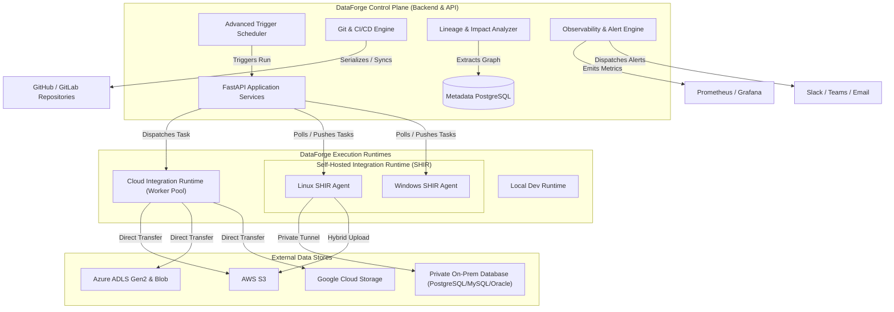
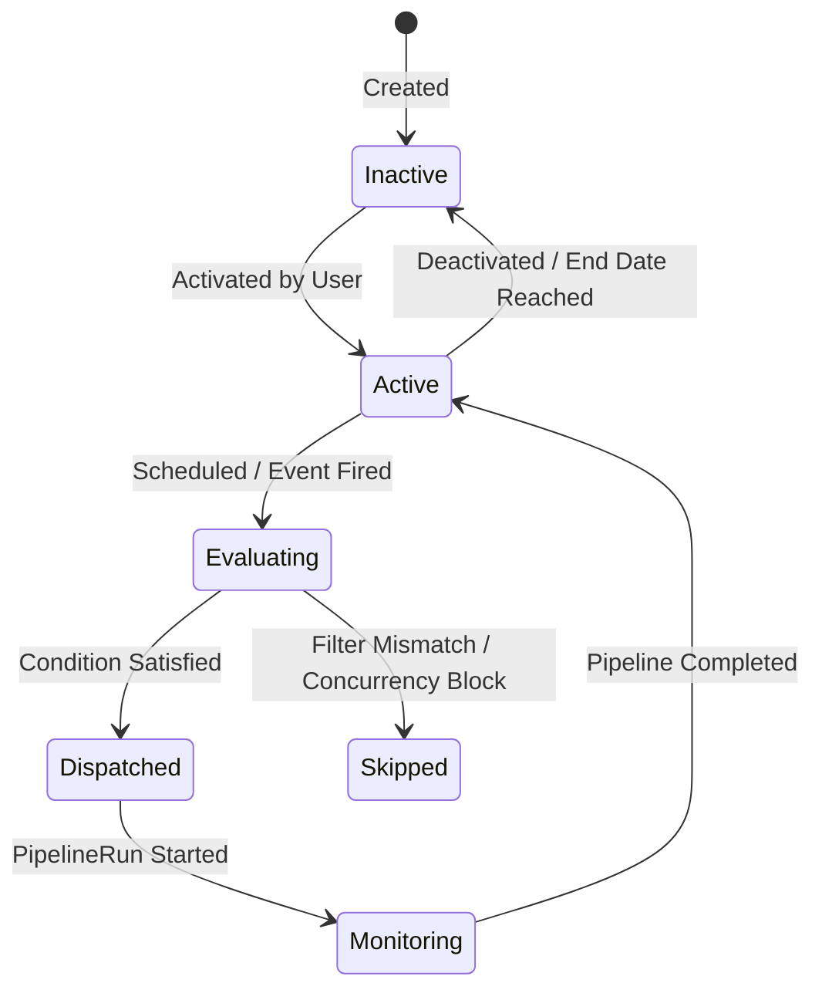
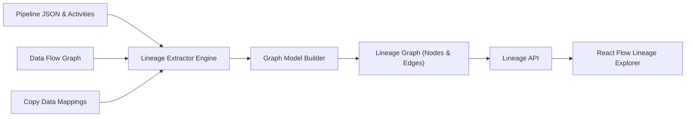

# DataForge — Six New Enterprise Features: Architecture Specification

## 1. System Architecture Overview

This architecture document defines the structural blueprints, data models, communication protocols, and execution workflows for the six new enterprise modules.



---

## 2. Feature 1: Integration Runtime Manager Architecture

### 2.1 Runtime Taxonomy
1. **Cloud Runtime (`Cloud`):** Managed, multi-threaded containerized worker pool running in the cloud environment. Ideal for cloud-to-cloud data movement and native SaaS operations.
2. **Self-Hosted Runtime (`SelfHosted`):** Customer-managed agent installed behind corporate firewalls or on private virtual networks. Pulls tasks securely over outbound HTTPS/WSS (no inbound firewall ports required). Provides native access to private relational databases (PostgreSQL, MySQL, Oracle, SQL Server) and on-premises file shares.
3. **Local Development Runtime (`LocalDev`):** Developer workstation runtime for rapid testing and pipeline validation.

### 2.2 Agent Registration & Authentication Flow
1. **Key Generation:** Administrator creates a Self-Hosted Runtime in DataForge UI. The control plane generates a cryptographically random, base64-encoded 256-bit registration key and stores its salted hash.
2. **Agent Installation:** Administrator executes the DataForge Agent installer on Linux (`bash install-agent.sh --key <KEY>`) or Windows (`Install-DataForgeAgent.ps1 -Key <KEY>`).
3. **Token Exchange:** Agent calls `POST /api/v1/runtimes/agent/register` presenting the registration key. The server validates the key and returns an encrypted JWT session credential.
4. **Heartbeat Protocol:** Agent dispatches `POST /api/v1/runtimes/agent/heartbeat` every 15 seconds containing:
   - Host metrics: CPU load percentage, RAM usage (used/total), disk space.
   - Execution capacity: Concurrency limit, active tasks, queued tasks.
   - Agent version and OS architecture.
5. **Offline Detection Daemon:** Background scheduler marks runtimes as `Offline` if no heartbeat is received within 60 seconds (configurable).

### 2.3 Task Dispatch & Workload Isolation
- When a pipeline run executes, `PipelineRunner` inspects the pipeline's assigned `runtime_id` (or activity runtime override).
- For `Cloud` runtimes, tasks are executed on the local background worker pool.
- For `SelfHosted` runtimes, tasks are enqueued in `runtime_tasks` table. The remote agent polls tasks via `POST /api/v1/runtimes/agent/poll-tasks`, executes the activity using isolated child processes, and posts incremental status updates.
- **Failover & Recovery:** If an agent drops offline during task execution, the control plane detects missed heartbeats, marks the task for retry, and recovers or alerts operators according to policy.

---

## 3. Feature 2: Reusable Dataset Management Architecture

### 3.1 Dataset Metamodel
Datasets abstract underlying physical storage into reusable enterprise entities:
- **Connection Reference:** Links to an existing verified `Connection`.
- **Location Specification:**
  - Filesystem/Bucket: `container` or `bucket`
  - Object Path: Directory prefix and file name pattern, supporting dynamic parameter expressions (e.g. `raw/events/@{formatDateTime(pipeline().parameters.WindowStart, 'yyyy/MM/dd')}/`).
  - Relational: Schema and table name, or explicit parameterized SQL query.
- **Format Configuration:** Links to DataForge format engines (CSV, Parquet, JSON, JSONL, Avro, ORC, Excel, Text) with compression and delimiter settings.
- **Schema Model:** Column names, data types, nullability, precision/scale, and primary key flags.

### 3.2 Schema Discovery & Drift Detection
- **Discovery:** On demand, DataForge inspects the underlying data source (reading Parquet/Avro/ORC file headers or querying relational database metadata `information_schema`) and infers the active schema.
- **Versioning:** Schema modifications create a new immutable `DatasetVersion` snapshot.
- **Drift Detection:** Compares the discovered source schema against the saved dataset version. Emits warnings or halts pipelines if critical columns are dropped or data types mutate.
- **Data Preview:** Reads at most 50-100 sample records with bounded memory footprint.

---

## 4. Feature 3: Advanced Trigger Management Architecture

### 4.1 Trigger State Machine & Taxonomy



1. **Schedule Trigger:** Recurrence based on hours, days, weeks, months, or custom cron expressions, with explicit timezone support and start/end boundaries.
2. **Storage Event Trigger:**
   - Evaluates storage arrival/deletion events across AWS S3 (S3 Event Notifications), Azure Blob (Event Grid), or GCP Storage.
   - Evaluates prefix (`raw/incoming/`) and suffix (`.parquet`) filters.
   - Passes event metadata (`@trigger().outputs.body.fileName`, `@trigger().outputs.body.folderPath`) into pipeline parameters.
   - Deduplication: Computes unique event hashes to prevent replay attacks or duplicate firings.
3. **Tumbling Window Trigger:**
   - Operates on non-overlapping, contiguous time slices (e.g., hourly, daily).
   - Passes `@trigger().outputs.windowStartTime` and `@trigger().outputs.windowEndTime`.
   - Supports window dependencies (window $N$ depends on window $N-1$) and concurrency limits.
   - Automatically backfills and recovers missed windows after system outages.
4. **Pipeline Dependency Trigger:**
   - Dispatches a downstream pipeline upon upstream pipeline terminal state (`Succeeded`, `Failed`, `Completed`).
   - Circular dependency detection via cycle-finding algorithm on dependency graphs.

---

## 5. Feature 4: Git Integration & CI/CD Architecture

### 5.1 Version Control Synchronization
- **Repository Provider:** Extensible interface (`BaseGitProvider`) with concrete implementations for `GitHubProvider` and `GitLabProvider`.
- **Resource Serialization:** Automatically serializes platform entities to standardized JSON files in the repository:
  ```text
  /
  ├── pipelines/
  │   ├── ingestion_sales_pipeline.json
  │   └── dw_transform_pipeline.json
  ├── datasets/
  │   ├── s3_raw_telemetry_dataset.json
  │   └── postgres_warehouse_dataset.json
  ├── triggers/
  │   ├── hourly_ingest_trigger.json
  │   └── storage_landing_trigger.json
  ├── runtimes/
  │   └── onprem_linux_ir.json
  └── .github/workflows/
      └── dataforge-deploy.yml
  ```
- **Secret Sanitization:** All credentials, tokens, and sensitive configurations are stripped before serialization. In Git, resources reference connection names or environment variables.
- **Branch Management & Diffing:** Supports switching branches, creating feature branches, visual three-way diffing between working copy and remote, commit, push, and pull.

### 5.2 CI/CD Environment Promotion Pipeline
- **Environment Tiers:** `Development` $\to$ `Testing` $\to$ `Staging` $\to$ `Production`.
- **Promotion Process:**
  1. Automated validation checks DAG integrity and references.
  2. Parameter substitution applies environment-specific configurations (e.g. database host, storage bucket).
  3. Approval gate requires administrator or lead engineer sign-off for Production.
  4. Deployment logs and rollback checkpoints are persisted.

---

## 6. Feature 5: Data Lineage and Impact Analysis Architecture

### 6.1 Lineage Extraction Pipeline


- **Pipeline-Level Lineage:** Maps dependencies: $\text{Source Dataset} \to \text{Activity} \to \text{Sink Dataset} \to \text{Downstream Pipeline}$.
- **Column-Level Lineage:** Maps exact column transformations:
  - Direct passthrough: $S.\text{col1} \to T.\text{col1}$
  - Renamed / Mapped: $S.\text{source\_id} \to T.\text{customer\_id}$
  - Derived / Aggregated: $S.\text{price} \times S.\text{qty} \to T.\text{total\_amount}$
  - Where SQL queries or complex scripts cannot be statically resolved, they are marked as `Partial` or `Unknown` rather than fabricating false relationships.
- **Impact Analysis Engine:** Graph traversal algorithm identifies all downstream activities, pipelines, and datasets affected if a source column or dataset is altered or deleted.

---

## 7. Feature 6: Advanced Monitoring and Observability Architecture

### 7.1 Telemetry Streams
1. **Copy Data Performance Stream:**
   - Records processed, written, and rejected.
   - Throughput (MB/s and rows/s), network transfer duration, file counts, and partition splits.
2. **Runtime Fleet Observability:**
   - Real-time CPU%, RAM%, active threads, queue length, and heartbeat latency across all runtimes.
3. **Multi-Channel Alert Dispatcher:**
   - **Email:** Standard SMTP with TLS and HTML email templates.
   - **Microsoft Teams:** Webhooks formatted as rich Adaptive Cards.
   - **Slack:** Webhooks formatted using Block Kit with direct run links.
   - **Generic Webhook:** JSON payloads signed with HMAC-SHA256 headers.
4. **Prometheus & OpenTelemetry:**
   - `/metrics` endpoint exposes Prometheus counters, gauges, and histograms.
   - Trace context injected with W3C `traceparent` headers and correlation IDs (`correlation_id`).
