# DataForge — Six New Enterprise Features: Implementation Roadmap

## 1. Roadmap Strategy

Implementation follows a strict, incremental phase-based schedule. Each phase is self-contained, unit-tested, integration-tested, manually verified, and documented before proceeding to the next.

```mermaid
flowchart LR
    P0["Phase 0: Audit & Specs"] --> P1["Phase 1: Runtime Manager"]
    P1 --> P2["Phase 2: Dataset Management"]
    P2 --> P3["Phase 3: Trigger Management"]
    P3 --> P4["Phase 4: Git & CI/CD"]
    P4 --> P5["Phase 5: Data Lineage"]
    P5 --> P6["Phase 6: Advanced Monitoring"]
    P6 --> P7["Phase 7: Integration Testing"]
    P7 --> P8["Phase 8: Production Hardening"]
```

---

## 2. Phase-by-Phase Execution Plan

### Phase 0: Existing Codebase Audit & Specifications
- Conduct comprehensive codebase audit of frontend, backend, database models, execution engine, and monitoring.
- Prepare gap analysis, architecture blueprint, roadmap, tracker, test strategy, and known limitations.
- Ensure existing features and test suite (236 passing tests) remain intact with zero code modifications during Phase 0.
- **Exit Gate:** All Phase 0 documentation created and user approval obtained.

---

### Phase 1: Integration Runtime Manager
- **Backend:**
  - Create database models: `IntegrationRuntime`, `RuntimeAgent`, `RuntimeTask`.
  - Implement runtime manager service: registration token generation, heartbeat monitoring, capacity tracking, online/offline detection daemon.
  - Implement remote agent protocol API endpoints (`register`, `heartbeat`, `poll-tasks`, `task-status`).
  - Create standalone Python runtime agent executable capable of running on Linux (systemd) and Windows.
  - Integrate runtime dispatcher into `PipelineRunner`: route activities to assigned runtime.
- **Frontend:**
  - Build Runtime Manager page (`/runtimes`): Fleet dashboard, status badges, CPU/RAM utilization gauges, registration wizard with copyable install scripts, active executions table.
  - Add runtime selector dropdown to Pipeline Designer settings and Activity drawer.
- **Testing:** Unit tests for registration and token validation; live agent mock integration tests.
- **Exit Gate:** Self-hosted runtime registers, heartbeats, receives dispatched activity, and reports completion. User approval required.

---

### Phase 2: Reusable Dataset Management
- **Backend:**
  - Create database models: `Dataset`, `DatasetVersion`.
  - Implement Dataset service: schema discovery, inference, versioning, drift detection, and low-memory preview.
  - Implement REST API (`/api/v1/datasets`): CRUD, preview, schema discovery, drift check, usages.
  - Integrate with `CopyDataActivity`: allow selecting source/sink dataset references with expression parameter resolution while preserving inline connections.
- **Frontend:**
  - Build Dataset Management page (`/datasets`): Dataset list, creation wizard (connection $\to$ path/table $\to$ format $\to$ schema discovery), schema viewer, preview modal, usage dependency graph.
  - Enhance Copy Data configuration drawer with Dataset selector toggle.
- **Testing:** Unit tests for schema inference, drift detection, dataset preview, and Copy Data execution using dataset references.
- **Exit Gate:** Reusable datasets can be created, discovered, previewed, and used inside Copy Data pipelines. User approval required.

---

### Phase 3: Advanced Trigger Management
- **Backend:**
  - Extend `Trigger` model: timezone, start/end dates, event configuration, tumbling window configuration, dependency configuration.
  - Create `TriggerRun` history model.
  - Implement trigger schedulers & listeners:
    - Schedule Trigger with timezone awareness and start/end boundaries.
    - Storage Event Trigger with file arrival listener, prefix/suffix filter, and deduplication.
    - Tumbling Window Trigger with window state management, backfill, and retry.
    - Pipeline Dependency Trigger with upstream status condition matching and cycle detection.
  - Implement REST API (`/api/v1/triggers`): CRUD, fire-now, trigger history, storage event webhook.
- **Frontend:**
  - Overhaul Triggers page (`/triggers`): Type-specific creation wizards, visual cron/recurrence editor, tumbling window settings, dependency picker, execution history drawer.
  - Add trigger quick-attach button to Pipeline Designer canvas.
- **Testing:** Unit tests for tumbling window calculations, dependency cycle detection, storage event filtering, and trigger history.
- **Exit Gate:** All 5 trigger types fire pipeline executions accurately with history logging. User approval required.

---

### Phase 4: Git Integration and CI/CD
- **Backend:**
  - Create database models: `GitRepository`, `Deployment`.
  - Implement Git engine: `BaseGitProvider`, `GitHubProvider` using GitHub REST API / Git CLI.
  - Implement canonical JSON serializer for pipelines, datasets, triggers, dataflows, runtimes (stripping secrets).
  - Implement Git operations API: connect repo, switch branch, list branches, commit & push, pull, change diff.
  - Implement CI/CD promotion engine: Dev $\to$ Test $\to$ Staging $\to$ Prod, parameter substitution, approval gates, rollback.
  - Generate GitHub Actions deployment workflow template.
- **Frontend:**
  - Add Git status & branch switcher widget to Top Navbar.
  - Build Git repository connection modal and visual change diff viewer.
  - Build Deployments & Release Management page (`/deployments`): Environment pipeline stages, promotion dialog, approval buttons, deployment logs.
- **Testing:** Unit tests for serialization, secret stripping, diff calculation, and promotion state machine.
- **Exit Gate:** Pipeline committed and pushed to remote branch; environment promotion executed with approval. User approval required.

---

### Phase 5: Data Lineage and Impact Analysis
- **Backend:**
  - Implement Lineage Extractor: parses pipeline JSON, activities, and DataFlow graphs to extract dataset/table nodes and directed edges.
  - Implement Column-Level Lineage Analyzer: extracts column transformations from Copy Data mappings and DataFlow transformations; flags partial/unknown mappings.
  - Implement Impact Analysis engine: traverses downstream graph to compute affected assets upon dataset or column modification.
  - Implement REST API (`/api/v1/lineage`): pipeline lineage, dataset lineage, column drilldown, impact analysis query.
- **Frontend:**
  - Build Lineage Explorer page (`/lineage`): Interactive React Flow graph, search filter, upstream/downstream path highlight, column-level drilldown drawer, impact analysis preview modal.
- **Testing:** Unit tests for pipeline-level graph generation, column mapping extraction, and impact analysis traversal.
- **Exit Gate:** Interactive lineage graph renders accurately; impact analysis correctly identifies downstream dependencies. User approval required.

---

### Phase 6: Advanced Monitoring and Observability
- **Backend:**
  - Implement Copy Data analytics aggregator: rejected rows, throughput MB/s, file/partition metrics.
  - Implement Runtime fleet monitoring service: CPU/RAM telemetry, active workers, queue depth.
  - Implement multi-channel alert dispatchers: Email (SMTP), Microsoft Teams, Slack, Webhooks.
  - Implement Prometheus `/metrics` endpoint.
  - Implement OpenTelemetry distributed tracing with correlation IDs (`correlation_id`).
- **Frontend:**
  - Extend Runs & Monitor page (`/runs`):
    - Copy Data detailed analytics tab (gauges, throughput charts, rejected row viewer).
    - Runtime fleet observability dashboard with live agent statuses and utilization graphs.
    - Alert channel configuration wizard (Teams, Slack, Email).
- **Testing:** Unit tests for alert dispatching, metric calculations, Prometheus scraping, and trace context propagation.
- **Exit Gate:** Prometheus scrapes `/metrics`; alert notifications dispatch to configured channels; Copy Data analytics display in UI. User approval required.

---

### Phase 7: Integration Testing
- Comprehensive end-to-end multi-feature testing:
  - Create dataset $\to$ assign to Copy Data $\to$ run on Self-Hosted Runtime $\to$ triggered by Storage Event $\to$ lineage tracked $\to$ committed to Git $\to$ monitored in observability dashboard.
- Verify zero regressions across existing pipeline execution and multi-cloud storage connectors.
- **Exit Gate:** All cross-feature integration test scenarios pass 100%. User approval required.

---

### Phase 8: Production Hardening, Security & Documentation
- Security audit: verify zero credential leakage in Git exports, runtime agent communications, logs, and API payloads.
- High-load stability: run multi-agent stress test.
- Final documentation sign-off and user acceptance report.
- **Exit Gate:** Production readiness sign-off. User approval required.
