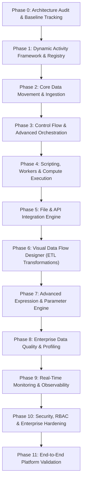

# DataFlow Enterprise — Master Implementation Roadmap (Phases 0–11)

**Version:** 1.0.0  
**Status:** Active Execution  

---

## Roadmap Phases Overview

---

## Detailed Milestone Descriptions

### Phase 0: Existing Architecture Audit & Gap Analysis (Current)
- Complete comprehensive repository code audit.
- Establish persistent tracking documents in `docs/`.
- Validate that all existing 14 test cases pass and the web app is operational on port 8000.
- Ensure 0 regressions to existing PostgreSQL, MySQL, and DAG orchestration capabilities.

### Phase 1: Activity Framework & Centralized Registry
- Implement `ActivityRegistry` with auto-discovery and `@register_activity` decorator.
- Standardize activity metadata: schema, category, versioning, inputs, outputs, icon.
- Expose `GET /api/v1/activities` endpoint for dynamic frontend toolbox loading.
- Decouple `factory.py` into pluggable registry pattern.
- Unit tests for activity registration, validation schemas, and versioning.

### Phase 2: Core Data Movement Activities
- Implement `GetMetadata` activity (discovers row counts, column lists, structure, existence).
- Implement `DeleteData` activity (safe delete queries, table truncation).
- Implement Bulk Load / Staging optimizations for PostgreSQL and MySQL.
- Parallel chunked streaming with producer-consumer buffer queue.
- Verified test: MySQL -> Copy Data -> PostgreSQL with 10,000+ records.

### Phase 3: Core Control Flow Activities
- Implement `ForEach` activity with sequential and parallel thread-pool execution.
- Implement `ExecutePipeline` (nested child pipeline execution with parameter forwarding).
- Implement `Switch` / Case multi-branch evaluator.
- Implement `Filter` activity (array filtering via predicate expressions).
- Implement `Until` loop activity with break condition.
- Implement `Fail` activity (deliberate pipeline termination with custom error message).
- Implement `AppendVariable` (list accumulation).

### Phase 4: Scripting and Compute Activities
- Implement `PythonScriptActivity` executed inside isolated sandbox process with resource and time limits.
- Implement `StoredProcedureActivity` supporting IN/OUT database parameters.
- Provider interfaces for PySpark / Databricks / Synapse execution.
- Real-time stdout/stderr log capture streamed to `ExecutionLog`.

### Phase 5: File and API Integration Activities
- Implement `WebActivity` / `Webhook` with HTTP pagination and OAuth2 token refresh.
- Implement Parquet and Excel readers/writers (`pyarrow`, `openpyxl`).
- Implement File system operations: `FileExists`, `ArchiveZip`, `ExtractZip`, `MoveFile`, `DeleteFile`.

### Phase 6: Visual Data Flow Designer
- Build dedicated second visual canvas specifically for Transformation Graphs.
- Batch 1: Source, Sink, Select, Filter, Derived Column, Sort.
- Batch 2: Join, Aggregate, Union, Conditional Split, Lookup, Exists.
- Batch 3: Pivot, Unpivot, Window, Rank, Flatten, Parse, Cast.
- Batch 4: Alter Row, Assert, Surrogate Key.
- Local high-speed vectorized processing via Polars and PySpark compiler.

### Phase 7: Expression and Parameter Framework
- Standardized parser for string, numeric, date, and array expressions.
- JSON path navigation and expression auto-complete schema provider.
- Full type-casting safety with error boundary isolation.

### Phase 8: Enterprise Data Quality
- Mandatory field, non-blank, duplicate check, referential integrity.
- Automated data profiling and source-to-target reconciliation.
- Quarantined dead-letter table routing.

### Phase 9: Monitoring and Observability
- Live WebSocket run execution logs.
- Duration metrics, rows read/written charts, bytes processed.
- Alert dispatchers (Webhook, Email, Slack).

### Phase 10: Enterprise Hardening
- RBAC with Keycloak / OIDC integration.
- HashiCorp Vault secrets provider.
- Pipeline version control with Git promotion across Dev, Test, Prod.

### Phase 11: End-to-End System Validation
- Complete integration test suite verifying 8 multi-stage enterprise scenarios.
