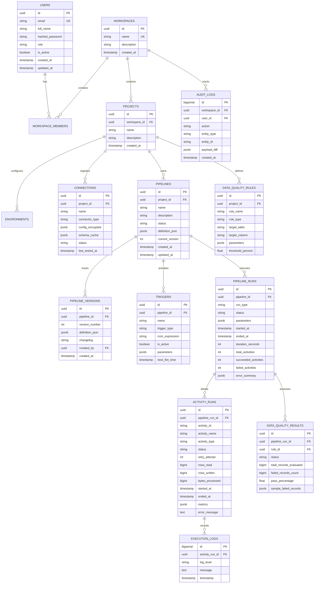

# DataFlow Enterprise — Database Schema & ER Diagram

## 1. Entity Relationship Diagram

---

## 2. Table Specifications & Indexes

1. **`users`**:
   - `id`: UUID (Primary Key, default uuid_generate_v4())
   - `email`: VARCHAR(255) UNIQUE NOT NULL
   - `hashed_password`: VARCHAR(255) NOT NULL
   - `role`: VARCHAR(50) NOT NULL (Admin, Engineer, Operator, Viewer)
   - Index on `email`.

2. **`connections`**:
   - Stores connection configurations. Sensitive attributes (passwords, tokens) stored encrypted in `config_encrypted` column using Fernet / AES-GCM.
   - Index on `(project_id, name)` unique per project.

3. **`pipelines`**:
   - `definition_json`: JSONB column containing nodes, edges, activity configs, and parameter schemas.
   - GIN index on `definition_json` for JSON querying.

4. **`pipeline_runs` & `activity_runs`**:
   - High write throughput. Indexes on `(pipeline_id, started_at DESC)`, `status`, and `pipeline_run_id`.
   - `rows_read`, `rows_written`, `bytes_processed` for operational reporting.
